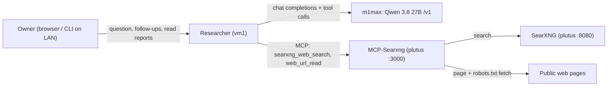
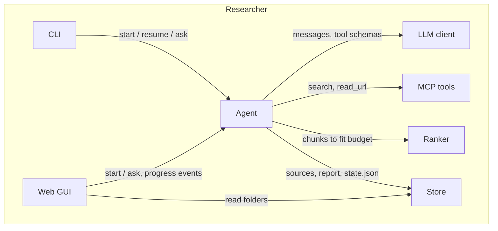

# Architecture

## Context

## Containers

## Parts

- **CLI**: `research`, `resume`, `ask`, `serve` subcommands. Has no logic of its own (SRS-FR-001, 010, 011).
- **Agent**: runs the plan → search → read → synthesize loop and the follow-up loop. Validates tool calls (NFR-004), applies retries (FR-009), and checkpoints after each step (FR-010).
- **LLM client**: OpenAI SDK pointed at the m1max. A process-wide `asyncio.Lock` lets only one request run at a time (NFR-002). Turns thinking on or off for each call (FR-017) and enforces the token budget (NFR-003).
- **MCP tools**: a single MCP client session to MCP-Searxng. It wraps `searxng_web_search` and `web_url_read`, and adds the robots.txt check, the per-domain wait and timeouts (FR-002, 003, 005, NFR-001).
- **Ranker**: splits sources into paragraph chunks, scores them by overlap with the question's terms, and returns the best chunks that fit the budget (NFR-003).
- **Store**: reads and writes research folders: `state.json`, `sources/NN-<domain>.md`, `report.md`, `followups.md`. Dedupes by URL hash (FR-003, 004, 006, 012).
- **Web GUI**: FastAPI app with server-rendered pages. Shows the folder list, report view with citation links, source view, follow-up chat, and a start-research form with an SSE progress log. It also serves `/health` (FR-013–016, NFR-007, 009).

## Stack

- Python 3.12, venv + pip, `pyproject.toml`. vm1 has no `uv`.
- `openai`: the m1max speaks OpenAI `/v1`.
- `mcp`: the official MCP client (streamable HTTP).
- `fastapi` + `uvicorn` + `jinja2`: the GUI, with SSE for progress.
- `markdown-it-py`: renders reports and sources as HTML.
- `pytest` + `pytest-asyncio`: tests with a fake model and fake MCP.
- Standard library for everything else: `urllib.robotparser`, `logging` with a JSON formatter, `hashlib`, `argparse`.

## Hard constraints

- No outbound connection except to `M1MAX_URL` and `MCP_URL` (NFR-001). Page and robots fetches go through `web_url_read`.
- No external search, scrape or LLM APIs, and no OmniRoute.
- Don't add tools that write, delete or send outside `research/`. v1 has no approval gates, so it can't have those tools.
- Tool definitions come from the MCP server. The Agent doesn't hard-code search or scrape logic beyond the robots and rate-limit wrapper.
- If tool calling on the m1max is broken, fix the server config. Don't parse tool calls out of prose.
- No database. The research folder is the only state.

## Decisions

### Decision 1

- **Context**: `todo.md` asks for SearXNG, a headless-browser scraper container and an MCP client.
- **Decision**: Use MCP-Searxng's `searxng_web_search` for search and its `web_url_read` (HTML/PDF → markdown) for scraping.
- **Rejected**: A separate Playwright scraper container. It adds about 1 GB and another service. Pages that need JavaScript come back thin, which is acceptable for v1.
- **SRS IDs**: SRS-FR-002, SRS-FR-003, SRS-NFR-001

### Decision 2

- **Context**: Research has to survive restarts, and sources have to sit next to the report.
- **Decision**: Each research folder holds its own `state.json` checkpoint. On startup, `resume` and `serve` scan for folders whose status is not `done`.
- **Rejected**: SQLite or Postgres task store. A second copy of state adds nothing for a single user.
- **SRS IDs**: SRS-FR-010, SRS-FR-004

### Decision 3

- **Context**: The m1max can only serve one request at a time, and the owner wants inference that is provably local.
- **Decision**: Call the m1max `/v1` directly with its own key, behind a single in-process lock.
- **Rejected**: OmniRoute, which could silently fall back to a cloud model. A separate queue service, which isn't needed with only one process.
- **SRS IDs**: SRS-NFR-001, SRS-NFR-002

## Primary design rule

none
